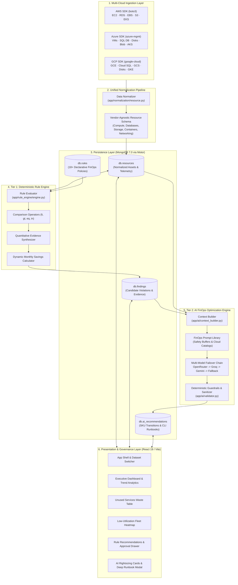
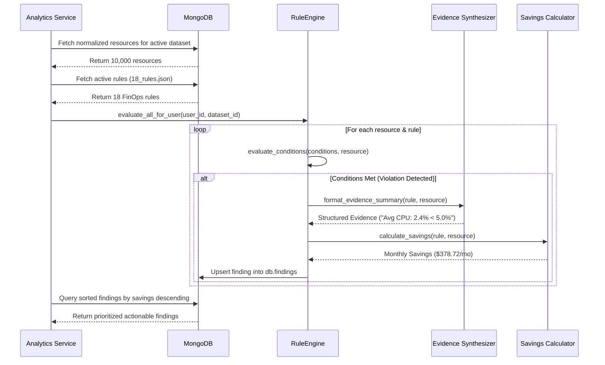
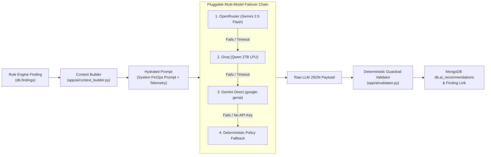

# Cloud Advisor · Complete Project Description & Architecture Specification

[](README.md)
[](backend/)
[](frontend/)
[-47A248.svg)](https://www.mongodb.com/)
[](backend/app/ai/)

---

## 1. Executive Summary & Problem Statement

Modern enterprise cloud adoption across **Amazon Web Services (AWS)**, **Microsoft Azure**, and **Google Cloud Platform (GCP)** introduces massive infrastructure sprawl. Engineering teams frequently deploy oversized compute instances, leave unattached storage volumes running post-migration, abandon idle staging databases, and fail to configure object storage lifecycle policies.

### The Core Challenges:
1. **Multi-Cloud Data Silos**: Each provider uses distinct APIs, metric naming conventions, billing formats, and resource hierarchies (AWS Accounts, Azure Subscriptions/Resource Groups, GCP Projects).
2. **Rule Blindness**: Traditional rule engines flag static violations (e.g., `CPU < 10%`), but output generic advice (e.g., *"Downsize instance"*), leaving engineers to manually calculate memory headroom, cross-reference SKU catalogs, and write Infrastructure-as-Code (IaC) scripts.
3. **Financial Hallucinations in Naive AI**: Standard LLMs cannot be trusted with cloud billing without strict telemetry grounding, instance catalog constraints, and deterministic safety buffers.
4. **Lack of Human Governance**: Automated cost-cutting tools that blindly terminate or resize resources risk production outages and violate enterprise SLA requirements.

### The Cloud Advisor Solution:
**Cloud Advisor** is an enterprise-grade multi-cloud FinOps intelligence and cost optimization platform. It combines a high-throughput **Deterministic Rule Engine (Tier 1)** for sub-second candidate detection across 10,000+ assets with an **Autonomous AI Optimization Engine (Tier 2)** powered by pluggable LLMs (Gemini 2.5 Flash, Groq Qwen 27B LPU, OpenRouter) and deterministic guardrails. All optimizations feed into an interactive, human-in-the-loop executive web console.

---

## 2. High-Level System Architecture

Cloud Advisor implements a **Two-Tier Hybrid Architecture** designed to balance real-time evaluation speed with deep cognitive reasoning:



---

## 3. Core Modules & Detailed Implementation

---

### Module 1: Multi-Cloud Ingestion & Connector Framework

The ingestion subsystem (`backend/app/providers/`) implements a decoupled connector architecture that abstracts provider-specific authentication, pagination, and API throttling.

#### 1. Connector Interface (`base.py`)
All provider implementations inherit from `CloudProviderConnector`:
```python
class CloudProviderConnector(ABC):
    @abstractmethod
    async def test_connection(self) -> bool:
        """Validates credentials and cloud API reachability."""
        pass

    @abstractmethod
    async def discover_resources(self) -> List[Dict[str, Any]]:
        """Queries provider APIs and returns raw resource payloads."""
        pass

    @abstractmethod
    async def get_metrics(self, resource_id: str, lookback_days: int) -> Dict[str, Any]:
        """Fetches CloudWatch, Azure Monitor, or GCP Monitoring metrics."""
        pass
```

#### 2. AWS Connector (`aws/connector.py`)
- **Authentication**: Leverages `boto3.client('sts')` with role assumption (`sts:AssumeRole`), generating short-lived temporary session tokens.
- **Resource Scope**:
  - `ec2`: Queries `DescribeInstances` for VM state, instance types, and VPC attachments.
  - `ebs`: Queries `DescribeVolumes` for attachment state, volume types (gp2, gp3, io1), and IOPS.
  - `rds`: Queries `DescribeDBInstances` for engine type, storage allocation, and compute tier.
  - `s3`: Queries `ListBuckets` and extracts lifecycle configuration rules.
  - `cloudwatch`: Queries metric statistics (`GetMetricData`) for `CPUUtilization`, `NetworkIn`, `NetworkOut`, and `DiskReadOps` over 14-day and 30-day lookback windows.

#### 3. Azure Connector (`azure/connector.py`)
- **Authentication**: Uses Azure Active Directory (Entra ID) service principals via `ClientSecretCredential`.
- **Resource Scope**:
  - `ComputeManagementClient`: Discovers Virtual Machines and Managed Disks.
  - `SqlManagementClient`: Retrieves Azure SQL Databases and Elastic Pools.
  - `StorageManagementClient`: Scans Blob Containers and tiering status.
  - `MonitorManagementClient`: Aggregates Azure Monitor metric time-series for average CPU, memory percentage, and disk throughput.

#### 4. GCP Connector (`gcp/connector.py`)
- **Authentication**: Utilizes Service Account keys or Google Cloud Workload Identity Federation.
- **Resource Scope**:
  - `google-cloud-compute`: Discovers Compute Engine instances, Persistent Disks, and Cloud NAT gateways.
  - `google-cloud-sql`: Queries Cloud SQL database instances (Postgres, MySQL, SQL Server).
  - `google-cloud-storage`: Checks Google Cloud Storage buckets for Nearline/Coldline lifecycle rules.
  - `google-cloud-monitoring`: Queries MQL / Metric time-series for GCE CPU, disk latency, and network egress.

#### 5. Security & Secret Handling
- Credentials are never logged or stored in plaintext.
- Cross-account access uses read-only IAM policies (`SecurityAudit`, `CostAndUsageReportAutomationPolicy`).

---

### Module 2: Unified Resource Normalization Pipeline

Disparate provider JSON payloads are transformed into a standardized, vendor-agnostic document format (`backend/app/normalization/resource.py`):

#### 1. Five Standardized Workload Categories
Every resource is categorized into one of five primary categories:
1. **Compute**: `compute_instance`, `serverless_container`, `serverless_function`, `app_service`
2. **Databases**: `database`, `nosql_table`, `cache_cluster`
3. **Storage**: `block_storage`, `object_storage`
4. **Containers & Kubernetes**: `kubernetes_cluster`, `container_registry`
5. **Networking**: `load_balancer`, `nat_gateway`, `virtual_network`, `network_egress`

#### 2. Normalized Data Model Schema (`backend/app/schemas/resource.py`)
```json
{
  "_id": "6741ab01e4b09c2a8f102345",
  "user_id": "usr_enterprise_01",
  "dataset_id": "bank_balanced",
  "cloud_account_id": "ca_aws_prod_01",
  "provider": "AWS",
  "account_id": "112233445566",
  "region": "us-east-1",
  "resource_id": "i-0f493dab5e83b5da3",
  "resource_name": "ml-train-gpu-01",
  "resource_type": "compute_instance",
  "service": "Amazon EC2",
  "category": "Compute",
  "status": "running",
  "configuration": {
    "instance_type": "g4dn.xlarge",
    "vcpus": 4,
    "memory_gb": 16.0,
    "os": "Linux/UNIX",
    "storage_gb": 125
  },
  "metrics": {
    "cpu_average": 2.4,
    "cpu_p95": 4.8,
    "memory_average": 18.2,
    "memory_p95": 24.1,
    "disk_iops_read": 12.0,
    "disk_iops_write": 25.0,
    "network_egress_gb": 1.4
  },
  "cost": {
    "hourly": 0.526,
    "monthly": 378.72,
    "currency": "USD"
  },
  "tags": {
    "Environment": "Production",
    "Team": "MachineLearning",
    "CostCenter": "AI-Research"
  },
  "last_synced_at": "2026-11-23T12:00:00Z"
}
```

---

### Module 3: Deterministic FinOps Rule Engine (Tier 1)

The Rule Engine (`backend/app/rule_engine/engine.py`) provides high-throughput policy evaluation across fleet resources without external API calls.



#### 1. Rule Definition Schema (`backend/18_rules.json`)
Rules are declarative JSON objects specifying evaluation conditions, lookback windows, and savings models:
```json
{
  "rule_id": "POLICY-AWS-EC2-001",
  "name": "Underutilized EC2 Instance",
  "description": "Flags running EC2 instances with average CPU utilization below 10% and memory below 30% over 14 days.",
  "provider": "aws",
  "resource_type": "compute_instance",
  "required_data": ["metrics.cpu_average", "metrics.memory_average", "cost.monthly"],
  "lookback_window": { "value": 14, "unit": "days" },
  "conditions": {
    "logic": "AND",
    "items": [
      { "field": "configuration.state", "operator": "eq", "threshold": "running" },
      { "field": "metrics.cpu_average", "operator": "lt", "threshold": 10.0 },
      { "field": "metrics.memory_average", "operator": "lt", "threshold": 30.0 }
    ]
  },
  "recommendation": {
    "type": "RIGHTSIZING_REVIEW",
    "action_template": "Rightsize instance {resource_name} ({configuration.instance_type}) to a lower capacity instance family."
  },
  "savings_calculation": {
    "type": "ESTIMATED_PERCENTAGE",
    "percentage": 50.0
  },
  "severity": "medium",
  "status": "active"
}
```

#### 2. Condition Evaluation Engine
Supports dynamic dot-notation path traversal (e.g., `metrics.cpu_average`) and operators:
- `eq` / `ne`: Equality / Inequality
- `lt` / `lte`: Less than / Less than or equal
- `gt` / `gte`: Greater than / Greater than or equal
- `in` / `not_in`: Set membership
- `contains`: Substring matching
- Logical groupings: `AND` / `OR` expressions

#### 3. Quantitative Evidence Synthesizer (`analytics_service.py`)
To prevent vague justifications, the engine computes exact metric contrasts:
```text
Avg CPU: 3.2% (rule threshold: < 10.0%) | RAM Avg: 18.4% (rule threshold: < 30.0%) | Monthly Cost: $148.50 | 14 days lookback
```

#### 4. The 18 Production FinOps Rules:
| Provider | Rule ID | Title | Condition Summary | Savings Model |
|---|---|---|---|---|
| **AWS** | `POLICY-AWS-EC2-001` | Underutilized EC2 Instance | State == running, CPU < 10%, RAM < 30% | 50% Rightsizing Cut |
| **AWS** | `POLICY-AWS-EC2-002` | Idle / Stopped EC2 Instance | State == running, CPU < 2% | 100% Decommission Cut |
| **AWS** | `POLICY-AWS-EBS-001` | Unattached EBS Volume | Attachment status == available > 7 days | 100% Volume Deletion |
| **AWS** | `POLICY-AWS-EBS-002` | Low-IOPS Provisioned Volume | Volume type in (io1, io2), IOPS < 100 | 60% GP3 Migration |
| **AWS** | `POLICY-AWS-RDS-001` | Over-Provisioned RDS Database | CPU < 15%, Active Connections < 5 | 50% Compute Downsize |
| **AWS** | `POLICY-AWS-S3-001` | S3 Missing Lifecycle Policy | Storage class == STANDARD, Lifecycle == 0 | 40% Glacier Tiering |
| **Azure** | `POLICY-AZURE-VM-001` | Underutilized Virtual Machine | PowerState == running, CPU < 12% | 50% SKU Downsize |
| **Azure** | `POLICY-AZURE-VM-002` | Stopped Virtual Machine Accruing Cost| PowerState == stopped, Storage Cost > $20 | 100% Compute Savings |
| **Azure** | `POLICY-AZURE-DISK-001`| Unattached Managed Disk | Disk state == unattached > 14 days | 100% Disk Cleanup |
| **Azure** | `POLICY-AZURE-SQL-001` | Oversized Azure SQL Database | DTU / vCore utilization < 10% | 50% Service Tier Downsize |
| **Azure** | `POLICY-AZURE-BLOB-001`| Blob Missing Cool/Archive Tiering | Tier == Hot, Access Frequency < 5% | 45% Cool Tier Migration |
| **Azure** | `POLICY-AZURE-AKS-001` | Under-Allocated AKS Node Pool | Node pool CPU allocation < 20% | 40% Cluster Rightsizing |
| **GCP** | `POLICY-GCP-GCE-001` | Underutilized Compute Engine VM | Status == RUNNING, CPU < 15% | 50% Machine Type Downsize |
| **GCP** | `POLICY-GCP-GCE-002` | Idle Compute Engine VM | Status == RUNNING, CPU < 3% over 14d | 100% Instance Termination |
| **GCP** | `POLICY-GCP-DISK-001`| Orphaned Persistent Disk | in_use == false > 7 days | 100% Snapshot & Delete |
| **GCP** | `POLICY-GCP-SQL-001` | Underutilized Cloud SQL Instance | CPU < 15%, Connections < 5 | 50% Tier Downsize |
| **GCP** | `POLICY-GCP-GCS-001` | GCS Bucket Lacking Lifecycle | Class == STANDARD, Rules count == 0 | 40% Nearline/Coldline |
| **GCP** | `POLICY-GCP-GKE-001` | Idle GKE Cluster Node Pool | Request/Capacity ratio < 25% | 45% Node Pool Sizing |

---

### Module 4: Autonomous AI Optimization Engine (Tier 2)

The AI engine (`backend/app/ai/`) elevates rule findings into concrete, production-ready engineering runbooks.



#### 1. Context Builder (`app/ai/context_builder.py`)
Fetches finding metadata and aggregates telemetry from MongoDB:
- Current SKU / instance tier
- 30-day average CPU, peak p95 CPU, and memory utilization
- Disk IOPS and network egress
- Monthly spend and tag topology (Environment, Team, App)

#### 2. FinOps System Instruction (`app/ai/prompt_library/base.py`)
Forces the LLM to act as a Principal Cloud Architect:
- **Safety Headroom**: Requires at least 20% buffer above peak (p95) observed utilization.
- **Architectural Preservation**: Forbids downsizing memory-intensive workloads to burstable instances if memory exceeds threshold.
- **Format Enforcement**: Enforces a strict JSON output matching `AIRecommendationResponse`.

#### 3. Pluggable Multi-Model Failover Chain (`app/ai/providers/`)
The engine implements resilient failover using standard provider adapters:
1. **OpenRouter Adapter**: Calls Google Gemini 2.5 Flash via OpenRouter REST endpoint.
2. **Groq Adapter**: High-speed inference using Qwen 2.5 27B on Groq LPUs.
3. **Gemini Direct Adapter**: Native Google Generative AI SDK connection.
4. **Deterministic Policy Fallback**: If all external LLM connections fail or API keys are unconfigured, a heuristic engine synthesizes accurate SKU transitions and CLI commands deterministically without throwing 500 errors.

#### 4. Deterministic Guardrails & Sanitizer (`app/ai/validator.py`)
Protects against hallucinated instance types or unrealistic savings:
- **Action Validation**: Restricts to `RIGHTSIZE`, `STOP`, `TERMINATE`, `STORAGE_DOWNGRADE`, `NO_ACTION`.
- **Financial Bounds**: Verifies `0 <= estimated_monthly_savings <= current_monthly_cost`.
- **Risk Assessment**: Enforces strict `LOW`, `MEDIUM`, or `HIGH` ratings based on workload criticality tags and peak utilization.
- **CLI Command Generation**: Produces copy-pasteable terminal commands:
  ```bash
  # AWS EC2 Rightsizing
  aws ec2 stop-instances --instance-ids i-0f493dab5e83b5da3 && \
  aws ec2 modify-instance-attribute --instance-id i-0f493dab5e83b5da3 --instance-type "{\"Value\": \"t4g.xlarge\"}" && \
  aws ec2 start-instances --instance-ids i-0f493dab5e83b5da3
  ```

---

### Module 5: Executive Dashboard & Multi-Cloud UI

The frontend (`frontend/src/`) is built with **React 19**, **TanStack Router / Start**, **Tailwind CSS v4**, and **Radix UI**.

#### 1. Executive Views
1. **Dashboard / Cost Usage (`/` and `/cost-usage`)**:
   - Total monthly spend run-rate, projected monthly and annual savings.
   - Provider breakdown cards (AWS, Azure, GCP) with active asset counts and average costs.
   - 6-month historical trend charts with provider stacking (Recharts).
   - Top 5 cost driver services with percentage share bars.
2. **Unused Services (`/unused-services`)**:
   - Filterable data table of idle assets, unattached disks, and orphan IPs.
   - Cost sparkline curves, last activity timestamps, and one-click inspection drawers.
3. **Low Utilization (`/low-utilization`)**:
   - Fleet-wide compute and database utilization heatmap.
   - CPU vs Memory metrics with progress bars, monthly cost, and recoverable savings.
4. **Rule Engine Recommendations (`/recommendations`)**:
   - Actionable recommendation cards grouped by provider and priority (High, Medium, Low).
   - Human review drawer displaying condition audit trail, confidence score (94%), and quantitative evidence.
   - Decision controls: **Approve**, **Reject** (with reason modal), **Snooze** (14/30 days), and **Schedule**.
5. **AI Recommendations Hub (`/ai-recommendations`)**:
   - Dedicated autonomous fleet analysis page.
   - Filterable by **Provider**, **Category** (Compute, Databases, Storage, Containers), **Action**, and **Risk**.
   - Hardware transition badge: `Current SKU` &rarr; `Target SKU`.
   - Batch Fleet Analysis trigger (`✨ Run AI Fleet Analysis`).
   - One-click CLI command clipboard copy.
   - Deep Runbook Modal dialog with 3-KPI grid, implementation checklist, and technical justification.

#### 2. Category & Service Display Engine (`frontend/src/mockData/cloud.ts`)
Ensures every card and modal displays the accurate cloud service name and workload category badge:
- `getCategoryForRecommendation(item)`: Dynamically resolves `Compute`, `Databases`, `Storage`, `Containers & Kubernetes`, or `Networking`.
- `getServiceForRecommendation(item)`: Dynamically resolves `Amazon EC2`, `Azure SQL Database`, `Google Kubernetes Engine (GKE)`, `Cloud Storage`, etc.

---

### Module 6: Synthetic Datasets & Seeding Mechanics

To enable realistic enterprise testing without live cloud billing access, Cloud Advisor includes three synthetic datasets in `synthetic data/`:

1. **`bank_balanced` (Global Bank Multi-Cloud)**:
   - **10,000 assets** perfectly balanced across AWS, Azure, and GCP.
   - High concentration of Kubernetes clusters (AKS, EKS, GKE), transactional databases (Cloud SQL, Azure SQL, RDS), and compliance logging storage.
   - Yields ~2,820 actionable findings and ~$118,000/mo in potential savings.
2. **`retail_balanced` (Enterprise Retail Fleet)**:
   - **10,000 assets** distributed across multi-region e-commerce microservices, Kafka event streams, Redis clusters, and auto-scaling compute.
   - Yields ~2,377 actionable findings and ~$94,000/mo in potential savings.
3. **`retail_2900` (Mid-Market Retail Fleet)**:
   - **2,900 assets** representing mid-market cloud infrastructure.
   - Yields ~86 actionable findings and ~$3,800/mo in potential savings.

#### Dataset Auto-Seeding Workflow:
```text
User Selects Dataset -> POST /api/dashboard/datasets/switch?dataset_id=...
   │
   ├── 1. Updates user's active dataset state in MongoDB
   ├── 2. Inspects db.resources; if unseeded, loads JSON from /synthetic data/
   ├── 3. Evaluates 18 FinOps rules across all seeded resources
   ├── 4. Upserts candidate findings into db.findings
   └── 5. Returns refreshed provider analytics, spend totals, and recommendations
```

---

## 4. Database Schema & Data Layer (MongoDB 7.0)

Cloud Advisor uses **MongoDB** via the **Motor** async driver.

### Core Collections:

#### 1. `users`
Stores enterprise user credentials, roles, and session states.
- Indexed on: `email` (unique)

#### 2. `cloud_accounts`
Stores metadata for connected cloud tenants (AWS accounts, Azure subscriptions, GCP projects).
- Indexed on: `user_id`, `provider`

#### 3. `resources`
Stores the normalized inventory and metrics.
- Indexed on: `(user_id, dataset_id, provider)`, `resource_id` (unique per account), `category`, `resource_type`

#### 4. `rules`
Stores the declarative FinOps policy definitions.
- Indexed on: `rule_id` (unique), `provider`, `resource_type`, `status`

#### 5. `findings`
Stores policy violations detected by the Rule Engine.
- Indexed on: `(user_id, dataset_id, status)`, `savings.monthly` (descending for fast triage), `resource_id`

#### 6. `ai_recommendations`
Stores enriched LLM rightsizing runbooks.
- Indexed on: `resource_id` (unique), `provider`, `category`, `status`, `estimated_monthly_savings`

---

## 5. Security & Governance Architecture

1. **Non-Destructive Operations**: Cloud Advisor never executes destructive infrastructure modifications autonomously. All recommendations require explicit human sign-off (**Human-in-the-Loop**).
2. **Role-Based Access Control (RBAC)**: User roles (`Enterprise Administrator`, `FinOps Analyst`, `Viewer`) govern approval permissions.
3. **JWT Authentication**: High-entropy HMAC-SHA256 tokens with configurable expiration (default 1,440 minutes).
4. **Zero Cloud Secret Persistence**: AWS IAM STS AssumeRole tokens are ephemeral (1 hour duration). Azure and GCP connections use managed identities or read-only service principals.
5. **Auditable Decision Tracking**: Every approval, snooze, or rejection is logged with actor, timestamp, and optional engineer justification notes stored in the audit trail.

---

## 6. End-to-End Execution Scenarios

### Scenario A: Telemetry Scan to Rule Finding Generation
1. Admin triggers a fleet scan or selects a dataset scope.
2. `DatasetService` loads the raw resource JSON and normalizes instances, storage, and databases into `db.resources`.
3. `RuleEngine.evaluate_all_for_user()` iterates through all 18 rules.
4. For instance `ml-train-gpu-01`, condition evaluations detect:
   - `configuration.state == 'running'` (True)
   - `metrics.cpu_average == 2.4% < 10.0%` (True)
   - `metrics.memory_average == 18.2% < 30.0%` (True)
5. `EvidenceSynthesizer` formats metric contrast: `"Avg CPU: 2.4% < 10.0% | RAM Avg: 18.2% < 30.0% | Lookback: 14 days"`.
6. `SavingsCalculator` computes monthly savings: `$378.72 * 0.50 = $189.36/mo`.
7. Finding document is stored in `db.findings` with status `open`.

### Scenario B: AI Rightsizing & CLI Runbook Generation
1. User clicks **AI Runbook** or runs **Batch Fleet Analysis**.
2. `ContextBuilder` aggregates finding telemetry, hardware SKU (`g4dn.xlarge`), and tag topology (`Environment: Production`).
3. `LLMProviderFactory` invokes Gemini 2.5 Flash / Groq Qwen 27B with the FinOps Prompt Library.
4. LLM analyzes 30-day telemetry, notes peak CPU was only 4.8%, and selects target SKU `t4g.xlarge` (providing 4 vCPUs, 16 GB RAM with 20% safety headroom).
5. `RecommendationValidator` verifies that `t4g.xlarge` is a valid cloud SKU, recalculates exact cost reduction ($189.36/mo), and generates the AWS CLI script.
6. The recommendation is stored in `db.ai_recommendations` and updated on the UI card.

### Scenario C: Human Review & Decision
1. Lead Engineer opens the **Deep Runbook Modal** on the web console.
2. Engineer inspects CPU/RAM charts, validates the 20% safety buffer, reviews the CLI script, and clicks **Approve Recommendation**.
3. Frontend issues `PATCH /api/ai/recommendations/status?resource_id=...&new_status=APPROVED`.
4. The status badge immediately transitions to `✓ APPROVED`, the decision is logged to the audit log, and the asset is queued for scheduled execution.

---

## 7. Technology & Verification Summary

- **Backend**: FastAPI with async route handlers, Pydantic v2 data models, Motor async MongoDB driver, Pytest test suite (9/9 tests passing).
- **Frontend**: React 19, TanStack Router with type-safe route trees, Tailwind CSS v4, Lucide icons, Vite 8 production build (verified client & SSR bundles).
- **Telemetry Store**: MongoDB 7.0 hosting over 20,000 active assets and 5,000+ evaluated findings.
- **AI Models**: Google Gemini 2.5 Flash, Groq Qwen 2.5 27B LPU, and deterministic policy failover.

---

## 8. Summary of Completed Architectural Deliverables

1. **Global Multi-Cloud Normalizer**: Fully vendor-agnostic representation for AWS, Azure, and GCP.
2. **Deterministic 18-Rule Engine**: High-throughput candidate detection with quantitative evidence synthesis.
3. **Pluggable AI Optimization Engine**: Multi-LLM failover, safety buffers, and copyable CLI runbooks.
4. **Executive SaaS Frontend**: Cost trends, unused service detection, utilization heatmaps, and approval drawers.
5. **Multi-Dataset Management**: Instant on-the-fly switching between enterprise banking and retail datasets.
6. **Container Orchestration**: Production-ready `docker-compose.yml` and `docker-compose.dev.yml`.
