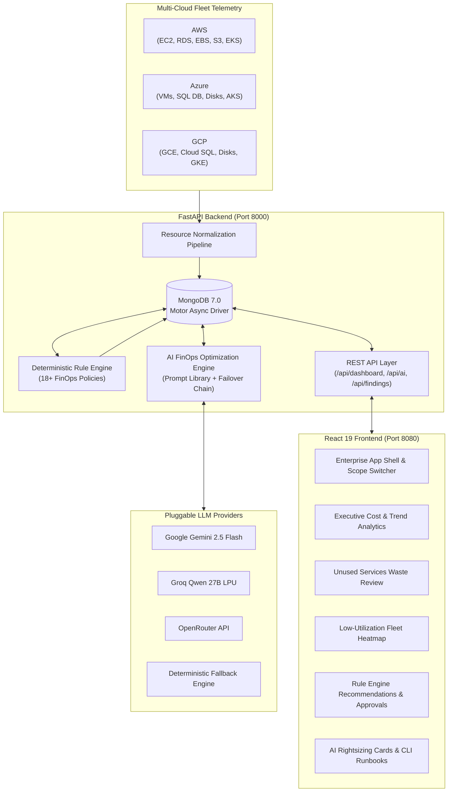

# Cloud Advisor · Enterprise Multi-Cloud FinOps & Cost Intelligence Platform

[](https://fastapi.tiangolo.com)
[](https://www.python.org/)
[](https://react.dev/)
[-47A248.svg?logo=mongodb&logoColor=white)](https://www.mongodb.com/)
[](https://tailwindcss.com/)
[](https://www.docker.com/)
[](LICENSE)

**Cloud Advisor** is an enterprise-grade multi-cloud FinOps intelligence and cost optimization platform designed for **Amazon Web Services (AWS)**, **Microsoft Azure**, and **Google Cloud Platform (GCP)**.

The platform continuously normalizes fleet-wide telemetry, identifies resource waste through a deterministic **18+ Rule Policy Engine**, and synthesizes actionable SKU rightsizing runbooks through an **Autonomous AI Optimization Engine** with automated provider failover.

---

## Table of Contents

- [Key Capabilities](#key-capabilities)
- [System Architecture](#system-architecture)
- [Tech Stack](#tech-stack)
- [Project Directory Structure](#project-directory-structure)
- [Prerequisites](#prerequisites)
- [Quick Start with Docker Compose](#quick-start-with-docker-compose)
- [Local Development Setup](#local-development-setup)
  - [1. MongoDB Database Setup](#1-mongodb-database-setup)
  - [2. Backend Setup (FastAPI)](#2-backend-setup-fastapi)
  - [3. Frontend Setup (React 19 + Vite)](#3-frontend-setup-react-19--vite)
- [Environment Configuration](#environment-configuration)
- [Multi-Cloud Synthetic Datasets](#multi-cloud-synthetic-datasets)
- [FinOps Rule Engine (18 Policies)](#finops-rule-engine-18-policies)
- [AI FinOps Optimization Engine](#ai-finops-optimization-engine)
- [Interactive API Documentation](#interactive-api-documentation)
- [Verification & Testing](#verification--testing)
- [Troubleshooting & FAQs](#troubleshooting--faqs)
- [License](#license)

---

## Key Capabilities

- **Unified Multi-Cloud Fleet Telemetry**: Automatically discovers and normalizes inventory from AWS, Azure, and GCP into a vendor-agnostic data model spanning **Compute**, **Databases**, **Storage**, **Containers & Kubernetes**, and **Networking**.
- **Deterministic FinOps Rule Engine**: Evaluates 18+ policy criteria over 14-to-30 day metric lookback windows (CPU average/p95, memory pressure, unattached volume duration, database IOPS).
- **Autonomous AI Rightsizing & Runbooks**: Powered by a pluggable LLM failover chain (**Gemini 2.5 Flash**, **Groq Qwen 27B LPU**, **OpenRouter**, or deterministic heuristics). Generates target SKU transitions (e.g. `c5.2xlarge` &rarr; `m6g.xlarge`), safety buffer analysis, and copyable CLI remediation commands.
- **Enterprise Executive Dashboard**: Real-time monthly cost run-rates, annualized savings projections, provider spend distribution, historical cost trends, and top service cost drivers.
- **Human-in-the-Loop Governance**: Approval workflow supporting **Approve**, **Reject**, **Snooze**, and **Schedule** actions with full audit trails and decision timestamps.
- **On-the-Fly Cloud Scope Switcher**: Seamlessly switch between enterprise datasets (10,000-asset Banking Fleet, 10,000-asset Retail Fleet, and 2,900-asset Mid-Market Fleet) directly from the header dropdown.
- **Dark & Light Interface**: Tailored dark-first SaaS aesthetic with responsive layout, fluid charts (Recharts), and Lucide icons.

---

## System Architecture



---

## Tech Stack

| Layer | Technologies | Purpose |
|---|---|---|
| **Frontend Framework** | **React 19**, **TanStack Router / Start** | Modern, performant UI with type-safe routing and state management |
| **Build & Styling** | **Vite 8**, **Tailwind CSS v4**, **Radix UI** | Rapid development, modern Dark/Light mode theme engine, accessible components |
| **Data Visualization** | **Recharts**, **Lucide React** | Interactive utilization curves, distribution charts, and icon system |
| **Backend Framework** | **Python 3.12+**, **FastAPI**, **Pydantic v2** | High-performance asynchronous REST API with automatic OpenAPI generation |
| **Database** | **MongoDB 7.0+**, **Motor (AsyncIO)** | Document database storing resources, findings, rules, accounts, and AI runbooks |
| **Rule Engine** | **Python Async Engine** | Data-driven condition evaluation, lookback aggregations, savings calculation |
| **AI / LLM Layer** | **Gemini 2.5**, **Groq**, **OpenRouter** | Multi-model failover chain for cloud SKU translation and runbook generation |
| **Authentication** | **JWT (python-jose)**, **Argon2 / Passlib** | Role-based token authentication and password hashing |
| **Containerization** | **Docker**, **Docker Compose** | Production and development multi-container orchestration |

---

## Project Directory Structure

```text
Cloud/
├── backend/                             # FastAPI Backend Service
│   ├── app/
│   │   ├── ai/                          # AI Optimization Engine
│   │   │   ├── prompt_library/          # FinOps prompts & SKU knowledge base
│   │   │   ├── providers/               # Gemini, Groq, OpenRouter, Mock adapters
│   │   │   ├── context_builder.py       # MongoDB telemetry synthesis for prompts
│   │   │   ├── service.py               # AI batch generation & lifecycle service
│   │   │   └── validator.py             # Deterministic guardrails & SKU sanitizer
│   │   ├── api/                         # FastAPI Routers
│   │   │   ├── ai_recommendations.py    # /api/ai endpoints
│   │   │   ├── auth.py                  # /api/auth login & register
│   │   │   ├── dashboard.py             # /api/dashboard analytics & dataset switch
│   │   │   ├── findings.py              # /api/findings management & status updates
│   │   │   ├── accounts.py              # /api/accounts cloud account management
│   │   │   ├── resources.py             # /api/resources inventory queries
│   │   │   └── rules.py                 # /api/rules FinOps policy management
│   │   ├── core/                        # Configuration & Security
│   │   ├── db/                          # MongoDB connection & index initialization
│   │   ├── normalization/               # Provider data mapping to unified schema
│   │   ├── providers/                   # AWS, Azure, GCP connector implementations
│   │   ├── rule_engine/                 # 18-rule evaluator, operators & calculators
│   │   ├── schemas/                     # Pydantic request/response validation
│   │   ├── services/                    # Analytics & Dataset seeding services
│   │   └── main.py                      # FastAPI application entrypoint
│   ├── tests/                           # Pytest unit & integration test suite
│   ├── 18_rules.json                    # Golden master FinOps policy definitions
│   ├── Dockerfile                       # Backend container definition
│   └── requirements.txt                 # Python dependencies
│
├── frontend/                            # React 19 Frontend Application
│   ├── src/
│   │   ├── components/
│   │   │   ├── cloud/                   # Views, AppShell, Drawers, Runbook Modal
│   │   │   └── ui/                      # Radix UI primitives (Button, Dialog, Select)
│   │   ├── config/                      # API client (`api.ts`) & backend connections
│   │   ├── mockData/                    # Offline fallback datasets & helper resolvers
│   │   ├── routes/                      # TanStack file-based routes
│   │   └── styles/                      # Tailwind CSS v4 styling rules
│   ├── Dockerfile                       # Frontend container definition
│   ├── package.json                     # Node.js dependencies & build scripts
│   └── vite.config.ts                   # Vite & TanStack build configuration
│
├── synthetic data/                      # Multi-Cloud Enterprise Telemetry Datasets
│   ├── bank_resources_aws_azure_gcp_balanced.json    # 10,000 Banking Fleet assets
│   ├── retail_resources_aws_azure_gcp_balanced.json  # 10,000 Retail Fleet assets
│   └── data.json                                     # 2,900 Mid-Market Retail assets
│
├── docs/                                # Technical & Architectural Documentation
├── docker-compose.yml                   # Production multi-container composition
├── docker-compose.dev.yml               # Development multi-container composition
└── README.md                            # Global Repository Guide & Documentation
```

---

## Prerequisites

Before setting up Cloud Advisor locally, ensure you have:

1. **Python**: Version `3.12` or newer (`python --version`)
2. **Node.js**: Version `20.x` or newer (`node -v`) and **npm** (`npm -v`)
3. **MongoDB**: Version `7.0+` Community Server running locally or via Docker
4. **Git**: Installed and configured on your system

---

## Quick Start with Docker Compose

The fastest way to spin up the entire platform (MongoDB, FastAPI Backend, and React Frontend) is using **Docker Compose**:

```bash
# 1. Clone the repository
git clone https://github.com/sairaj1729/cloud-adviser.git
cd cloud-adviser

# 2. Launch all services
docker compose up --build
```

Once running:
- **Web Frontend**: Open [http://localhost:8080](http://localhost:8080)
- **FastAPI Backend Swagger**: Open [http://localhost:8000/api/docs](http://localhost:8000/api/docs)
- **MongoDB**: Listening on `localhost:27017`

To shut down services:
```bash
docker compose down
```

---

## Local Development Setup

Follow these steps to run each service natively on your workstation for active development.

### 1. MongoDB Database Setup

Cloud Advisor requires a running MongoDB instance on port `27017`.

#### Option A: Native MongoDB (Windows / macOS / Linux)
Start your local MongoDB service:

```powershell
# Windows (Example command):
& "C:\Program Files\MongoDB\Server\7.0\bin\mongod.exe" --dbpath "C:\data\db" --port 27017 --bind_ip 127.0.0.1
```

```bash
# macOS (Homebrew):
brew services start mongodb-community@7.0

# Linux (systemd):
sudo systemctl start mongod
```

#### Option B: Standalone MongoDB via Docker
```bash
docker run -d --name cloud_advisor_mongodb -p 27017:27017 -v mongodb_data:/data/db mongo:7.0
```

---

### 2. Backend Setup (FastAPI)

1. Open a terminal and navigate to the `backend/` directory:
   ```bash
   cd backend
   ```

2. Create and activate a Python virtual environment:
   ```bash
   # Windows (PowerShell):
   python -m venv venv
   .\venv\Scripts\Activate.ps1

   # Linux / macOS:
   python3 -m venv venv
   source venv/bin/activate
   ```

3. Install required Python packages:
   ```bash
   pip install --upgrade pip
   pip install -r requirements.txt
   ```

4. Configure environment variables:
   ```bash
   # Copy sample environment configuration
   cp .env.example .env
   ```
   *(Ensure `MONGODB_URI` points to `mongodb://localhost:27017` in your `.env` file).*

5. Start the FastAPI development server:
   ```bash
   python -m uvicorn app.main:app --reload --host 0.0.0.0 --port 8000
   ```

6. Verify the backend:
   Open **[http://localhost:8000/api/docs](http://localhost:8000/api/docs)** in your browser to view the interactive OpenAPI Swagger documentation.

---

### 3. Frontend Setup (React 19 + Vite)

1. Open a new terminal and navigate to the `frontend/` directory:
   ```bash
   cd frontend
   ```

2. Install Node dependencies:
   ```bash
   npm install
   ```

3. Configure frontend environment:
   Create a `.env` file in `frontend/`:
   ```env
   VITE_API_URL=http://localhost:8000/api
   ```

4. Start the Vite development server:
   ```bash
   npm run dev
   ```

5. Access the application:
   Open **[http://localhost:8080](http://localhost:8080)** in your browser.

---

## Environment Configuration

### Backend (`backend/.env`)

| Variable | Default Value | Description |
|---|---|---|
| `PROJECT_NAME` | `Cloud Advisor V1 Backend` | Human-readable application title |
| `API_V1_STR` | `/api` | Root API route prefix |
| `PORT` | `8000` | Port for FastAPI server |
| `MONGODB_URI` | `mongodb://localhost:27017` | MongoDB connection string |
| `MONGODB_DATABASE` | `cloud_advisor` | Target MongoDB database name |
| `SECRET_KEY` | `super_secret_jwt_key...` | HMAC-SHA256 JWT signing secret key |
| `ACCESS_TOKEN_EXPIRE_MINUTES` | `1440` | JWT expiration duration in minutes |
| `GEMINI_API_KEY` | *(Optional)* | Google Gemini API key for live LLM recommendations |
| `GROQ_API_KEY` | *(Optional)* | Groq API key for high-speed LPU inference |
| `OPENROUTER_API_KEY` | *(Optional)* | OpenRouter API key for third-party model routing |

### Frontend (`frontend/.env`)

| Variable | Default Value | Description |
|---|---|---|
| `VITE_API_URL` | `http://localhost:8000/api` | Target FastAPI backend base endpoint URL |

---

## Multi-Cloud Synthetic Datasets

Cloud Advisor includes three realistic enterprise multi-cloud datasets located in `synthetic data/`. Each dataset contains normalized compute, database, storage, Kubernetes, and networking telemetry:

| Dataset ID | Name | Assets | Domain | File |
|---|---|---|---|---|
| `bank_balanced` | **Global Bank Multi-Cloud** | **10,000** | Banking & FinTech | `bank_resources_aws_azure_gcp_balanced.json` |
| `retail_balanced` | **Enterprise Retail Fleet** | **10,000** | Retail & Supply Chain | `retail_resources_aws_azure_gcp_balanced.json` |
| `retail_2900` | **Mid-Market Retail Fleet** | **2,900** | Omnichannel Retail | `data.json` |

### Automatic Seeding & Switching
When you switch datasets via the UI header selector:
1. The frontend invokes `POST /api/dashboard/datasets/switch?dataset_id=<id>`.
2. The backend dynamically seeds MongoDB `resources` if not already indexed.
3. The Rule Engine automatically re-evaluates all 18 rules across the selected dataset.
4. The dashboard and all sub-views immediately update to reflect the new fleet analytics.

---

## FinOps Rule Engine (18 Policies)

The data-driven Rule Engine (`backend/app/rule_engine/engine.py`) reads policies from `backend/18_rules.json` and evaluates concrete metrics against configurable thresholds:

### AWS Policies
- `POLICY-AWS-EC2-001`: Underutilized EC2 Instance (CPU average < 10% and memory < 30% over 14 days)
- `POLICY-AWS-EC2-002`: Idle / Stopped EC2 Instance (CPU average < 2% over 7 days)
- `POLICY-AWS-EBS-001`: Unattached EBS Volume (Volume state is `available` for > 7 days)
- `POLICY-AWS-EBS-002`: Low-IOPS Provisioned GP2/IO1 Volume (< 100 IOPS average)
- `POLICY-AWS-RDS-001`: Over-Provisioned RDS Database (CPU < 15% and connection count < 5)
- `POLICY-AWS-S3-001`: Infrequently Accessed S3 Bucket without Lifecycle Tiering

### Azure Policies
- `POLICY-AZURE-VM-001`: Underutilized Azure Virtual Machine (CPU < 12%)
- `POLICY-AZURE-VM-002`: Deallocated / Stopped Virtual Machine still accruing storage costs
- `POLICY-AZURE-DISK-001`: Unattached Managed Disk (`unattached` state > 14 days)
- `POLICY-AZURE-SQL-001`: Oversized Azure SQL Database (DTU / vCore utilization < 10%)
- `POLICY-AZURE-BLOB-001`: Blob Container missing Cool/Archive lifecycle management
- `POLICY-AZURE-AKS-001`: Low Node Allocation in Azure Kubernetes Service (AKS)

### GCP Policies
- `POLICY-GCP-GCE-001`: Underutilized Compute Engine VM (CPU average < 15%)
- `POLICY-GCP-GCE-002`: Idle Compute Engine VM (CPU < 3% over 14 days)
- `POLICY-GCP-DISK-001`: Orphaned Persistent Disk (in-use status = false)
- `POLICY-GCP-SQL-001`: Underutilized Cloud SQL Instance (CPU < 15% and connections < 5)
- `POLICY-GCP-GCS-001`: Cloud Storage Bucket without Nearline / Coldline transitions
- `POLICY-GCP-GKE-001`: Idle Google Kubernetes Engine (GKE) Cluster Node Pool

---

## AI FinOps Optimization Engine

Located in `backend/app/ai/`, the AI engine provides autonomous rightsizing:

- **Telemetry Grounding**: Extracts 30-day CPU, RAM, disk IOPS, and network egress telemetry from MongoDB.
- **Prompt Library**: Pre-built prompt templates grounded with FinOps best practices, safety buffers (20% headroom), and cloud instance catalogs.
- **Multi-Model Failover Chain**:
  ```text
  1. OpenRouter (Gemini 2.5) ──[fails]──> 2. Groq (Qwen 27B) ──[fails]──> 3. Gemini Direct ──[fails]──> 4. Deterministic Heuristic Engine
  ```
- **Deterministic Guardrails**: Validates recommended SKUs against safety constraints, calculates exact cost differentials, and generates executable shell commands (`aws ec2 modify-instance-attribute`, `az vm resize`, `gcloud compute instances set-machine-type`).
- **One-Click Runbooks**: Engineers can view complete architecture explanations and copy the remediation command directly from the card.

---

## Interactive API Documentation

FastAPI automatically generates interactive Swagger and ReDoc documentation:

- **Swagger UI**: [http://localhost:8000/api/docs](http://localhost:8000/api/docs)
- **ReDoc UI**: [http://localhost:8000/api/redoc](http://localhost:8000/api/redoc)

### Primary API Routes

| Endpoint | Method | Description |
|---|---|---|
| `/api/auth/register` | `POST` | Register a new administrator account |
| `/api/auth/login` | `POST` | Authenticate and obtain JWT bearer token |
| `/api/dashboard/analytics` | `GET` | Retrieve complete fleet analytics, spend curves, and findings |
| `/api/dashboard/summary` | `GET` | Get executive summary metrics (savings, accounts, assets) |
| `/api/dashboard/datasets/list` | `GET` | List available multi-cloud datasets with item counts |
| `/api/dashboard/datasets/switch`| `POST` | Switch active enterprise dataset and trigger evaluation |
| `/api/findings` | `GET` | Query rule engine findings with provider and severity filters |
| `/api/findings/{id}/status` | `PATCH` | Update recommendation status (approved, scheduled, rejected) |
| `/api/ai/recommend` | `POST` | Generate deep AI rightsizing analysis for a specific asset |
| `/api/ai/batch-generate` | `POST` | Run batch AI analysis across prioritized open fleet findings |
| `/api/ai/recommendations` | `GET` | List stored AI recommendations and SKU transitions |

---

## Verification & Testing

### Backend Unit & Integration Tests
Run the test suite using `pytest`:

```bash
cd backend
pytest tests/ -v
```

All provider normalization tests, rule engine evaluation tests, and API contract tests will run against mock provider fixtures.

### Frontend Production Build Test
Verify TypeScript compilation and client asset minification:

```bash
cd frontend
npm run build
```

---

## Troubleshooting & FAQs

### 1. `uvicorn.exe` blocked by Windows Application Control
If Windows AppLocker or Application Control restricts running `uvicorn.exe` directly:
```powershell
# Run uvicorn via Python module execution:
python -m uvicorn app.main:app --reload --host 0.0.0.0 --port 8000
```

### 2. Backend Cannot Connect to MongoDB (`ConnectionRefusedError`)
- Verify that your MongoDB service or Docker container is running:
  ```powershell
  # Check if port 27017 is listening:
  Test-NetConnection -ComputerName 127.0.0.1 -Port 27017
  ```
- Ensure `MONGODB_URI` in `backend/.env` is set to `mongodb://localhost:27017` (or `mongodb://mongodb:27017` when inside Docker).

### 3. Frontend Displays Offline Fallback Data
- Verify that the backend is running on `http://localhost:8000`.
- Verify that `frontend/.env` contains `VITE_API_URL=http://localhost:8000/api`.
- Check browser console (`F12`) for any CORS or network errors.

### 4. Port Conflicts
- Default Backend Port: `8000`
- Default Frontend Port: `8080`
- Default MongoDB Port: `27017`
If any port is occupied, adjust the corresponding port configuration in `.env` and `docker-compose.yml`.

---

## License

This project is licensed under the [MIT License](LICENSE).
