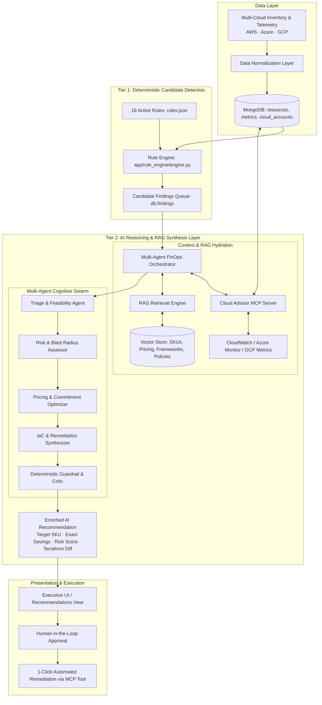
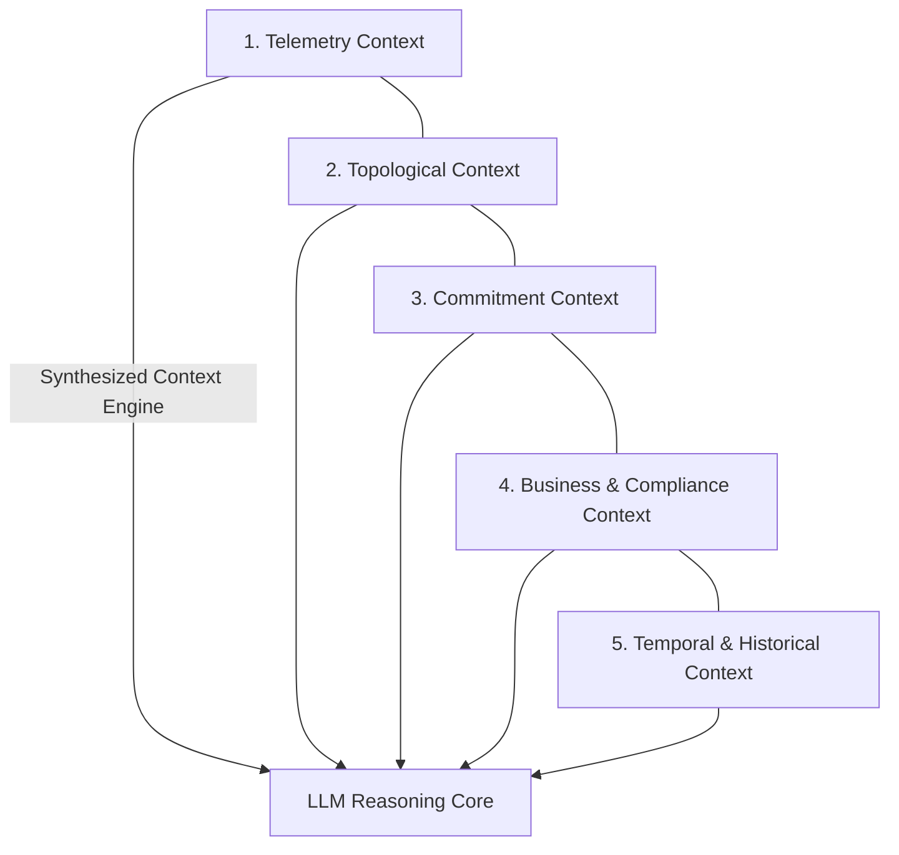
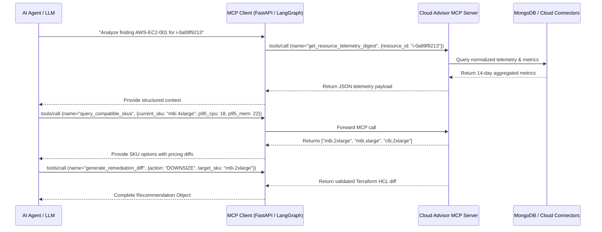
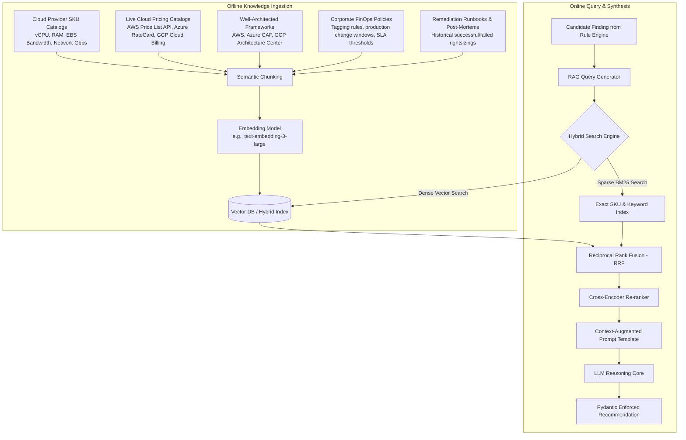
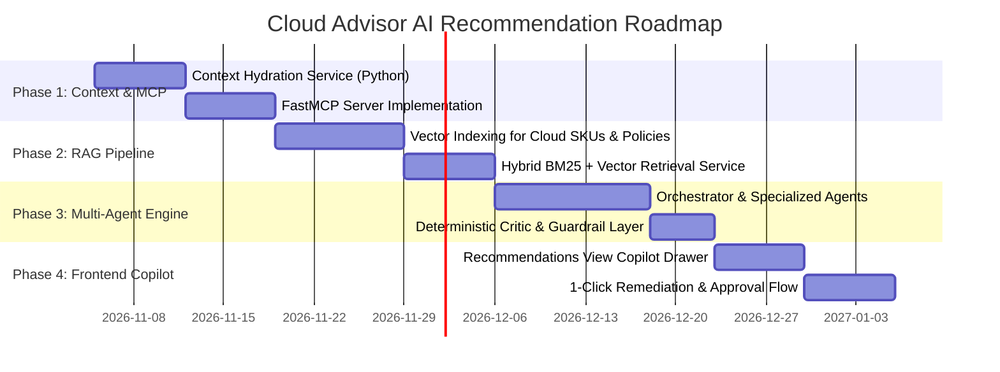

# AI System Design for Recommendations: Context, MCP, and RAG Framework

## Executive Summary

Cloud Advisor currently operates a **deterministic Rule Engine** (`app/rule_engine/engine.py`) that evaluates normalized cloud telemetry against 18 declarative FinOps rules (`rules.json`). While this engine excels at high-throughput candidate identification across 10,000+ multi-cloud resources in seconds, rule engines suffer from inherent limitations:
1. **Rule Blindness**: Rules evaluate static thresholds (e.g., `CPU < 25%`) in isolation, oblivious to application topology, seasonal traffic spikes, standby failover architectures, or commitment contracts (Reserved Instances/Savings Plans).
2. **Generic Recommendations**: Traditional rules output generic instructions (e.g., *"Downsize instance to a smaller SKU"*), forcing engineers to manually determine target SKUs, calculate memory ratios, and write Infrastructure-as-Code (IaC) scripts.
3. **Absence of Risk & SLA Context**: Rules cannot assess business blast radius, migration downtime, or compliance implications (e.g., PCI-DSS/HIPAA).

This document outlines the **AI System Design** to transform Cloud Advisor into an **Autonomous FinOps Intelligence & Recommendation Platform**. It integrates:
* **Deep Context Engineering**: Telemetry, topology, financial commitments, and business policies.
* **Model Context Protocol (MCP)**: A standardized, open protocol decoupling the AI reasoning agent from underlying cloud connectors, databases, and execution tools.
* **Retrieval-Augmented Generation (RAG)**: Grounding recommendations in real-time cloud SKU catalogs, live pricing APIs, cloud architecture frameworks, and internal organization runbooks.
* **The Two-Tier Hybrid Architecture**: Marrying deterministic rule speed with LLM cognitive reasoning.

---

## 1. High-Level AI System Architecture: The Two-Tier Recommendation Pipeline

To ensure sub-second response times, zero financial hallucinations, and cost-effective LLM token utilization, Cloud Advisor employs a **Two-Tier Hybrid Pipeline**:



### Why the Two-Tier Model is Mandatory
* **Tier 1 (Deterministic Filtering)**: Evaluating 10,000 resources directly with LLM prompts would cost hundreds of dollars per scan and take minutes. The Python Rule Engine scans 10,000 resources in < 3 seconds, filtering out 9,500 healthy resources and flagging ~500 candidate anomalies.
* **Tier 2 (Cognitive Enrichment)**: The AI Engine evaluates only the ~500 flagged candidates. It applies multi-source RAG, deep contextual lookups, risk scoring, and generates production-ready Terraform code with human-in-the-loop controls.

---

## 2. The Concept of Context in Multi-Cloud FinOps

In AI systems, **Context** is the set of facts, constraints, dependencies, and temporal dynamics the model must know to make an optimal, non-hallucinated decision. 

In cloud cost optimization, taking an action based solely on single-metric telemetry (e.g., `avg_cpu = 12%`) is dangerous. A complete FinOps context requires **five distinct layers**:



### The 5 Context Layers

| Context Layer | Data Sources | Critical Questions the AI Must Answer |
| :--- | :--- | :--- |
| **1. Telemetry Context** | CloudWatch, Azure Monitor, GCP Cloud Monitoring, Prometheus | Is CPU low because the instance is oversized, or is it memory-bound (`RAM = 94%`)? What is the P95/P99 distribution? Are there network bandwidth or disk IOPS bottlenecks? |
| **2. Topological Context** | Kubernetes Node Pools, DB Replica Sets, Load Balancer Target Groups, VPC/VNet maps | Is this VM an idle standalone host, or a Kubernetes worker node running 28 active microservice pods? Is it a standby replica in an active-passive Multi-AZ database cluster? |
| **3. Financial & Commitment Context** | AWS Cost Explorer, Azure Cost Management, GCP BigQuery Billing | Is this asset covered by a 3-Year All-Upfront Reserved Instance or Compute Savings Plan? If downsized, does the organization save $0 while leaving committed capacity unused? |
| **4. Business & Compliance Context** | Resource Tags (`Env`, `Owner`, `Service`, `Compliance`), Service Catalog | Is this instance tagged `Env=Production` or `Env=Dev`? Does this service store healthcare or payment data requiring specific isolation hardware (HIPAA, PCI-DSS)? |
| **5. Temporal & Historical Context** | MongoDB `findings` audit history, Deployment change logs, GitOps history | Was this instance deployed 2 days ago for a load test? Did a previous rightsizing attempt cause latency thrashing and get rolled back? Is it seasonal (Black Friday / Quarter-End)? |

### Context Window Engineering & Token Budgeting

Feeding 10,000 raw JSON documents into an LLM exceeds context windows (even 1M tokens) and introduces **Context Rot** (loss of precision in large token spaces). 

Cloud Advisor uses **Selective Context Hydration**:

```text
Raw Candidate (Rule Engine Finding)
          │
          ▼
Context Hydrator (MongoDB + Telemetry Aggregator)
          │
          ├─► Extracts 30-day statistical digest: [avg, p50, p95, p99, min, max]
          ├─► Resolves tags: {env: "prod", owner: "checkout-team", tier: "frontend"}
          ├─► Checks commitment ledger: {ri_covered: false, sp_eligible: true}
          └─► Fetches topology: {cluster: "eks-prod-eu", node_pool: "general-compute"}
          │
          ▼
Token-Dense Semantic Prompt (~650 tokens per candidate finding)
```

---

## 3. Model Context Protocol (MCP) Architecture

### What is MCP?
The **Model Context Protocol (MCP)**, open-sourced by Anthropic, is an open standard that allows AI models to securely connect to external tools, databases, and resources through a standardized JSON-RPC 2.0 interface.

Instead of hardcoding custom API wrappers for every LLM or embedding provider, **Cloud Advisor exposes itself as an MCP Server**:



### Cloud Advisor MCP Specification

#### 1. MCP Resources (Exposing Read-Only State)
```text
cloudadvisor://inventory/resources/{resource_id}     # Normalized resource specs
cloudadvisor://findings/pending/{provider}           # Open candidate findings
cloudadvisor://telemetry/digest/{resource_id}        # P50/P95/P99 metric distributions
cloudadvisor://commitments/coverage/{account_id}     # Active RI/Savings Plans ledger
cloudadvisor://policies/governance                   # Corporate tagging & downtime rules
```

#### 2. MCP Tools (Exposing Callable Capabilities)
Cloud Advisor exposes the following standardized tools to the reasoning agent:

| Tool Name | Parameters | Return Value | Description |
| :--- | :--- | :--- | :--- |
| `get_resource_context` | `resource_id: str` | `ResourceContextObject` | Hydrates full 5-layer context for a single resource. |
| `query_pricing_matrix` | `provider: str, sku: str, region: str` | `PricingRates` | Returns on-demand, 1yr/3yr RI, and Spot pricing. |
| `evaluate_ri_impact` | `account_id: str, current_sku: str` | `CommitmentStatus` | Determines whether rightsizing frees cash or wastes an upfront RI. |
| `search_cloud_docs` | `query: str, provider: str` | `List[DocSnippet]` | RAG semantic search across Well-Architected docs. |
| `generate_iac_remediation` | `finding_id: str, target_sku: str` | `IaCDiff` | Generates Terraform, AWS CLI, or Azure Bicep code. |
| `execute_cloud_remediation` | `finding_id: str, dry_run: bool` | `ExecutionResult` | Executes automated remediation upon human approval. |

#### 3. MCP Tool Implementation Example (`backend/app/mcp/tools.py`)
```python
from mcp.server.fastmcp import FastMCP
from app.db.mongodb import db_manager
from app.services.analytics_service import AnalyticsService

mcp = FastMCP("CloudAdvisor-FinOps-Server")

@mcp.tool()
async def get_resource_context(resource_id: str) -> dict:
    """Fetch complete normalized resource configuration, metrics digest, and tags."""
    db = db_manager.db
    resource = await db.resources.find_one({"resource_id": resource_id})
    if not resource:
        return {"error": f"Resource {resource_id} not found"}
    
    # Calculate statistical digest
    metrics = resource.get("metrics", {})
    return {
        "resource_id": resource["resource_id"],
        "resource_name": resource.get("name"),
        "provider": resource.get("provider"),
        "resource_type": resource.get("resource_type"),
        "configuration": resource.get("configuration", {}),
        "tags": resource.get("tags", {}),
        "monthly_cost": resource.get("cost", {}).get("monthly", 0.0),
        "metrics_digest": {
            "cpu_avg": metrics.get("cpu_average"),
            "cpu_p95": metrics.get("cpu_p95", metrics.get("cpu_average", 0) * 1.25),
            "memory_avg": metrics.get("memory_average"),
            "memory_p95": metrics.get("memory_p95", metrics.get("memory_average", 0) * 1.15),
            "disk_read_iops": metrics.get("disk_read_ops", 0),
            "disk_write_iops": metrics.get("disk_write_ops", 0),
        }
    }

@mcp.tool()
async def query_target_skus(provider: str, current_sku: str, target_family: str = None) -> list:
    """Query valid cloud rightsizing target SKUs maintaining architecture & CPU/Memory safety margins."""
    # Queries RAG SKU Vector Database / Static Matrix
    ...
```

---

## 4. Retrieval-Augmented Generation (RAG) Architecture

LLMs are prone to hallucinating cloud instance types (e.g., inventing `t4g.3xlarge` which does not exist, or proposing an x86 SKU for an ARM Graviton workload). **RAG grounds the LLM in real-world infrastructure catalogs and corporate policies.**



### Knowledge Domains in the Cloud Advisor RAG Corpus

#### 1. Hardware & SKU Architecture Catalog
* Comprehensive specs for **AWS EC2/RDS**, **Azure VM/SQL**, **GCP GCE/Cloud SQL**.
* Microarchitecture specifications: Intel Xeon vs AMD EPYC vs AWS Graviton (ARM64).
* Generation upgrade paths: `m5.4xlarge` $\to$ `m6i.2xlarge` (20% higher IPC, lower price) or `m7g.2xlarge` (Graviton3, 40% price-performance gain).
* Storage throughput baselines: Dedicated EBS bandwidth (Mbps) and IOPS limits to ensure downsizing does not cause storage bottlenecks.

#### 2. Real-Time Pricing & Commitment Rates
* Live On-Demand pricing per region.
* Standard 1-Year and 3-Year No-Upfront / All-Upfront Reserved Instance pricing.
* AWS Compute Savings Plans / Azure Savings Plans / GCP Committed Use Discounts (CUD).

#### 3. Organizational Governance & FinOps Policies
* Custom policy documents stored in `docs/` or MongoDB:
  * *"Production databases must have Multi-AZ enabled; never recommend Single-AZ downscaling for Prod."*
  * *"Changes to Tier-1 Banking applications require maintenance windows: Sundays between 02:00 - 04:00 UTC."*
  * *"Tagging requirements: Must contain Owner, Environment, and CostCenter."*

#### 4. Historical Remediation Lessons Learned (Memory Store)
* Vectorized records of past engineer decisions:
  * *"Downsizing order-processing cluster from 16 to 8 nodes on Oct 2025 resulted in p99 queue latency spikes during peak hour. Minimum node count clamped to 12."*

### Hybrid Search Implementation (Dense + Sparse BM25)
Cloud instance SKUs (e.g., `Standard_D8s_v5`, `db.r6g.2xlarge`, `n2-standard-16`) are alphanumeric tokens that dense semantic embeddings frequently blur together. 
* **BM25 Sparse Retrieval** matches the exact SKU token and provider region.
* **Dense Vector Embeddings** match architectural intent (e.g., *"memory optimized compute for Redis cache"*).
* **Reciprocal Rank Fusion (RRF)** fuses both rank lists:
  $$\text{RRF Score}(d) = \sum_{m \in M} \frac{1}{60 + r_m(d)}$$

---

## 5. Multi-Agent Reasoning Swarm for Recommendation Synthesis

To eliminate hallucinations and generate production-grade IaC code, the AI recommendation pipeline divides labor across **specialized agent personas**:

```text
               Candidate Finding (Rule Engine: CPU < 25%, lookback 14d)
                                      │
                                      ▼
                        ┌───────────────────────────┐
                        │   1. Triage & Filtering   │
                        │          Agent            │
                        └─────────────┬─────────────┘
                                      │ (Passes validation)
                                      ▼
                        ┌───────────────────────────┐
                        │    2. RAG & Knowledge     │
                        │     Retrieval Agent       │
                        └─────────────┬─────────────┘
                                      │ (SKUs, Pricing, Policies)
                                      ▼
                        ┌───────────────────────────┐
                        │   3. Risk & Blast Radius  │
                        │      Assessor Agent       │
                        └─────────────┬─────────────┘
                                      │ (Downtime & SLA verified)
                                      ▼
                        ┌───────────────────────────┐
                        │   4. IaC & Remediation    │
                        │      Synthesis Agent      │
                        └─────────────┬─────────────┘
                                      │ (Terraform / CLI diff)
                                      ▼
                        ┌───────────────────────────┐
                        │   5. Deterministic Guard  │
                        │        & Critic           │
                        └─────────────┬─────────────┘
                                      │ (Pydantic schema validation)
                                      ▼
                           Verified AI Recommendation
```

### Agent Roles & Responsibilities

1. **Triage & Filtering Agent**:
   * Evaluates if the candidate finding is a false positive (e.g., standby failover node, batch processing job that only runs at midnight).
2. **RAG & Knowledge Retrieval Agent**:
   * Queries the Cloud Advisor MCP Server and Vector DB to fetch target SKU specs, regional pricing, and organizational constraints.
3. **Risk & Blast Radius Assessor Agent**:
   * Analyzes downtime impact (e.g., *"EC2 instance type change requires reboot: estimated downtime 90-120 seconds"*).
   * Verifies HA redundancy (e.g., *"Cluster has 3 replicas across 3 AZs; rolling restart will maintain zero downtime"*).
   * Assigns a **Confidence Score (0-100%)** and **Risk Tier (Low / Medium / High)**.
4. **IaC & Remediation Synthesis Agent**:
   * Generates exact, copy-pasteable or automatically executable remediation code:
     * **Terraform HCL snippet** with variable diff.
     * **AWS CLI / Azure CLI / gcloud command**.
     * **Rollback Command** in case of performance degradation.
5. **Deterministic Guardrail & Critic**:
   * Validates mathematical calculations deterministically in Python (verifies that `calculated_savings = current_cost - target_cost`).
   * Ensures output adheres strictly to the `EnrichedRecommendationSchema`.

---

## 6. Concrete Data Contracts & Schemas

### Enriched AI Recommendation Schema (`app/schemas/ai_recommendation.py`)

```python
from pydantic import BaseModel, Field
from typing import List, Optional, Dict, Any
from enum import Enum

class RiskLevel(str, Enum):
    LOW = "LOW"          # Zero downtime, rolling update, reversible
    MEDIUM = "MEDIUM"    # Brief reboot required (< 2 mins), dev/staging environment
    HIGH = "HIGH"        # Production database resize, architectural change

class ExecutionType(str, Enum):
    AUTOMATED_1CLICK = "AUTOMATED_1CLICK"
    TERRAFORM_PR = "TERRAFORM_PR"
    MANUAL_RUNBOOK = "MANUAL_RUNBOOK"

class EnrichedAIRecommendation(BaseModel):
    finding_id: str
    resource_id: str
    resource_name: str
    provider: str  # "AWS" | "Azure" | "GCP"
    category: str  # "RIGHTSIZING" | "IDLE_CLEANUP" | "STORAGE_TIERING" | "COMMITMENT_PURCHASE"
    
    # Financial Impact
    current_monthly_cost: float
    target_monthly_cost: float
    estimated_monthly_savings: float
    savings_percentage: float
    currency: str = "USD"
    
    # Technical Recommendation
    current_sku: str
    recommended_sku: str
    architectural_justification: str = Field(
        description="Clear explanation of why this target was chosen, referencing CPU/Memory p95 headroom."
    )
    
    # Risk, Governance & Blast Radius
    risk_level: RiskLevel
    confidence_score: float = Field(ge=0.0, le=1.0)
    downtime_expected_seconds: int
    blast_radius_assessment: str
    prerequisites: List[str]
    rollback_plan: str
    
    # Executable Artifacts
    execution_type: ExecutionType
    iac_diff: Dict[str, str] = Field(
        description="Terraform HCL before/after diff or CLI commands"
    )
    cli_command: str
    rollback_command: str
    
    # Audit & Provenance
    evaluated_at: str
    model_version: str
    rag_sources: List[str]
```

### Example Generated AI Recommendation Output
```json
{
  "finding_id": "find_aws_eks_node_0821",
  "resource_id": "i-0b44a89f92138a0f",
  "resource_name": "eks-prod-eu-worker-pool-m6i4xlarge-04",
  "provider": "AWS",
  "category": "RIGHTSIZING",
  "current_monthly_cost": 554.80,
  "target_monthly_cost": 277.40,
  "estimated_monthly_savings": 277.40,
  "savings_percentage": 50.0,
  "currency": "USD",
  "current_sku": "m6i.4xlarge",
  "recommended_sku": "m6i.2xlarge",
  "architectural_justification": "Over the past 14 days, this worker node exhibited average CPU of 14.2% and p95 CPU of 22.8% (max 3.6 vCPUs used out of 16). Peak memory consumption was 18.4 GB out of 64 GB (28.7%). Downsizing to m6i.2xlarge (8 vCPUs, 32 GB RAM) provides 120% headroom over historical p95 peaks while cutting instance spend in half.",
  "risk_level": "LOW",
  "confidence_score": 0.94,
  "downtime_expected_seconds": 0,
  "blast_radius_assessment": "Low risk. Resource is managed under Kubernetes NodeGroup 'general-compute'. Pods will be gracefully drained via Kubernetes PodDisruptionBudgets (PDBs) to companion nodes in eu-west-1b/c with zero client interruption.",
  "prerequisites": [
    "Verify companion nodes have at least 18 GB allocatable memory headroom before draining.",
    "Ensure cluster autoscaler min_size is set <= current active node count."
  ],
  "rollback_plan": "If pod scheduling latency increases > 5%, run: terraform apply with previous instance_type variable or trigger Karpenter provisioner scale-up.",
  "execution_type": "AUTOMATED_1CLICK",
  "iac_diff": {
    "file": "terraform/modules/eks/nodegroup.tf",
    "diff": "- instance_types = [\"m6i.4xlarge\"]\n+ instance_types = [\"m6i.2xlarge\"]"
  },
  "cli_command": "aws eks update-nodegroup-config --cluster-name eks-prod-eu --nodegroup-name general-compute --scaling-config minSize=3,maxSize=12,desiredSize=6",
  "rollback_command": "aws eks update-nodegroup-config --cluster-name eks-prod-eu --nodegroup-name general-compute --scaling-config desiredSize=8",
  "evaluated_at": "2026-11-02T02:40:00Z",
  "model_version": "claude-3-7-sonnet / finops-agent-v1",
  "rag_sources": [
    "AWS EC2 M6i Specification Catalog (2026.1)",
    "Amazon EKS Best Practices Guide: Worker Node Rightsizing",
    "Enterprise FinOps Policy: Prod EKS Autoscale Buffer v3.2"
  ]
}
```

---

## 7. Strategic Implementation Roadmap for Cloud Advisor

To implement this AI system without disrupting existing functionality:



### Phase 1: Context Hydration Layer & FastMCP Server (2 Weeks)
* Build `app/services/context_service.py` to aggregate 30-day statistical digests and topology maps.
* Implement `app/mcp/server.py` using `FastMCP`, exposing read tools for resources, metrics, and findings.
* Connect local AI coding assistants and internal scripts directly via MCP.

### Phase 2: Domain RAG Ingestion (2 Weeks)
* Ingest AWS, Azure, and GCP SKU matrices (CPU, Memory, Network, Storage IOPS, On-Demand & RI Pricing).
* Ingest corporate governance rules and the Well-Architected Framework guidelines.
* Implement hybrid search using MongoDB Vector Search or ChromaDB + BM25 ranking.

### Phase 3: Agentic Reasoning & Guardrails (2 Weeks)
* Implement the 5-Agent pipeline (Triage $\to$ RAG $\to$ Risk Assessor $\to$ IaC Generator $\to$ Deterministic Guard).
* Enforce strict Pydantic parsing with automated retries.
* Store enriched AI recommendations alongside findings in MongoDB (`db.ai_recommendations`).

### Phase 4: UI Copilot & 1-Click Remediation (2 Weeks)
* Add an **"AI Explain & Remediate"** drawer to `frontend/src/components/cloud/Views.tsx`.
* Render interactive before/after resource diffs, risk badges, and the copy-ready Terraform snippet.
* Enable 1-Click approval that calls the Cloud Advisor MCP remediation tool to execute cloud actions safely.
