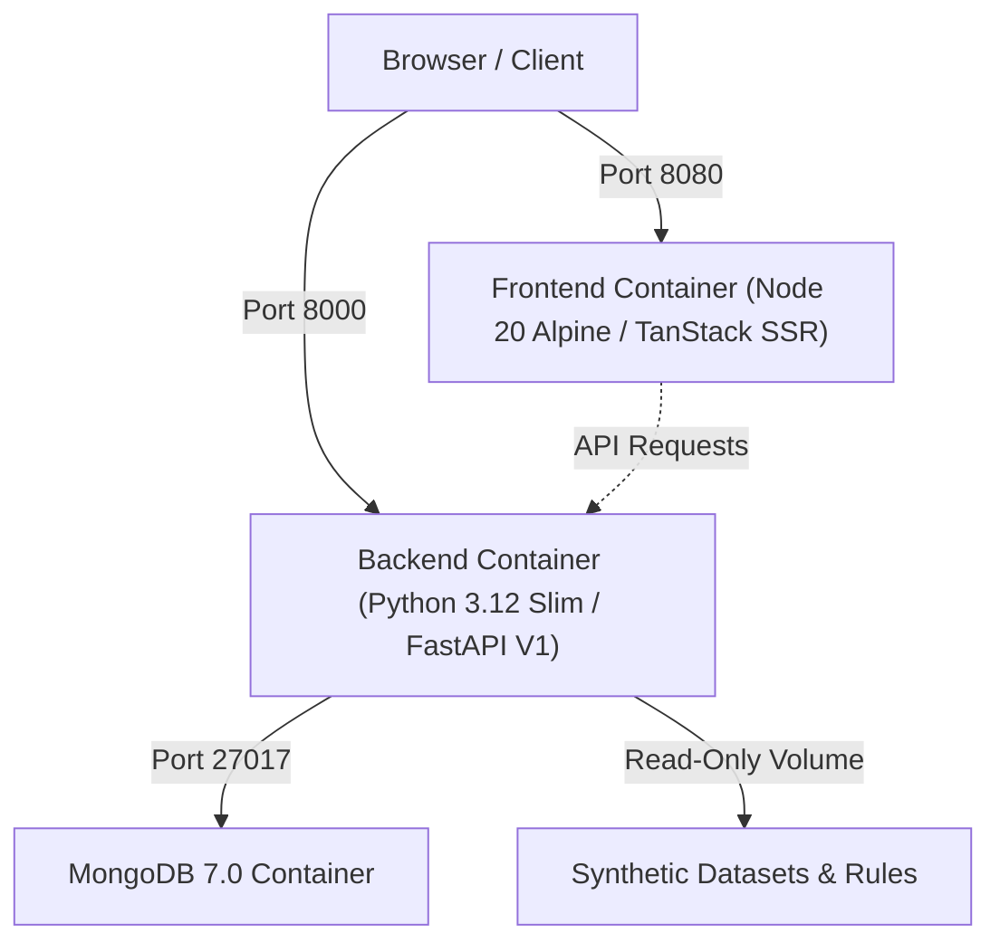

# Cloud Advisor: Docker Deployment & Containerization Guide

This document provides complete instructions for building, deploying, and managing **Cloud Advisor** using Docker and Docker Compose.

---

## 1. Architecture Overview

The containerized stack consists of three orchestrated microservices:



| Service | Container Name | Base Image | Port | Description |
| :--- | :--- | :--- | :--- | :--- |
| **`mongodb`** | `cloud_advisor_mongodb` | `mongo:7.0` | `27017` | Persistent document database for resources, findings, active dataset choices, and rules. |
| **`backend`** | `cloud_advisor_backend` | `python:3.12-slim` | `8000` | FastAPI V1 REST API, 18-rule FinOps engine, and dataset evaluation pipeline. |
| **`frontend`** | `cloud_advisor_frontend` | `node:20-alpine` | `8080` | Multi-stage production build running TanStack Start Node.js SSR server and modern React UI. |

---

## 2. Prerequisites

* **Docker Engine** (`>= 24.0`)
* **Docker Compose** (`>= v2.20` or Docker Compose v5)
* *(Windows users)*: Ensure WSL2 backend or Hyper-V is enabled in Docker Desktop settings.

---

## 3. Quick Start (Production Mode)

To build all container images and launch the entire stack in the background:

```bash
# 1. Build and start all services
docker compose up --build -d

# 2. View real-time aggregated logs
docker compose logs -f

# 3. View status of running containers
docker compose ps
```

Once running:
* **Web UI**: Open [http://localhost:8080](http://localhost:8080)
* **Backend API Documentation**: Open [http://localhost:8000/api/docs](http://localhost:8000/api/docs)
* **API Alternative Docs (ReDoc)**: Open [http://localhost:8000/api/redoc](http://localhost:8000/api/redoc)
* **MongoDB**: Accessible on `localhost:27017`

---

## 4. Development Mode (With Hot Reloading)

For active feature development where changes in `frontend/src` or `backend/app` should reflect instantly inside the running containers without rebuilding:

```bash
# Run with the development compose file
docker compose -f docker-compose.dev.yml up --build
```

---

## 5. Configuration & Environment Variables

### Backend Configuration (`backend`)

| Variable | Default Value | Description |
| :--- | :--- | :--- |
| `MONGODB_URI` | `mongodb://mongodb:27017` | MongoDB connection string within the Docker bridge network. |
| `MONGODB_DATABASE` | `cloud_advisor` | Target MongoDB database name. |
| `SYNTHETIC_DATA_DIR` | `/app/synthetic data` | Directory where multi-cloud JSON datasets reside. |
| `SECRET_KEY` | `super_secret_jwt_key...` | Cryptographic secret for signing JWT tokens. |
| `CORS_ORIGINS` | `*` | Allowed origins for cross-origin resource sharing. |

### Frontend Configuration (`frontend`)

| Variable | Default Value | Description |
| :--- | :--- | :--- |
| `PORT` | `8080` | Internal server listen port. |
| `HOST` | `0.0.0.0` | Network binding interface. |
| `VITE_API_URL` | `http://localhost:8000/api` | Base URL used by browser client to communicate with the FastAPI backend. |

---

## 6. Common Operations & Maintenance

### Stopping the Stack
```bash
docker compose down
```

### Stopping and Purging Database Volumes (Fresh Reset)
```bash
docker compose down -v
```

### Inspecting Backend Logs
```bash
docker compose logs -f backend
```

### Inspecting Frontend Logs
```bash
docker compose logs -f frontend
```

### Executing Commands Inside Containers
```bash
# Open interactive bash in Backend
docker compose exec backend bash

# Open Mongo Shell
docker compose exec mongodb mongosh cloud_advisor
```
